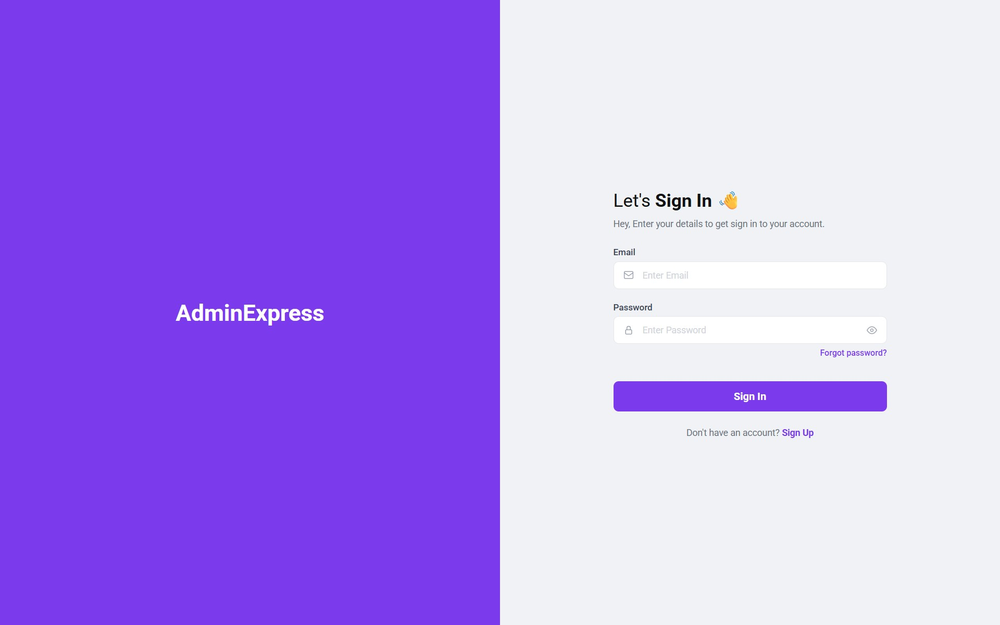
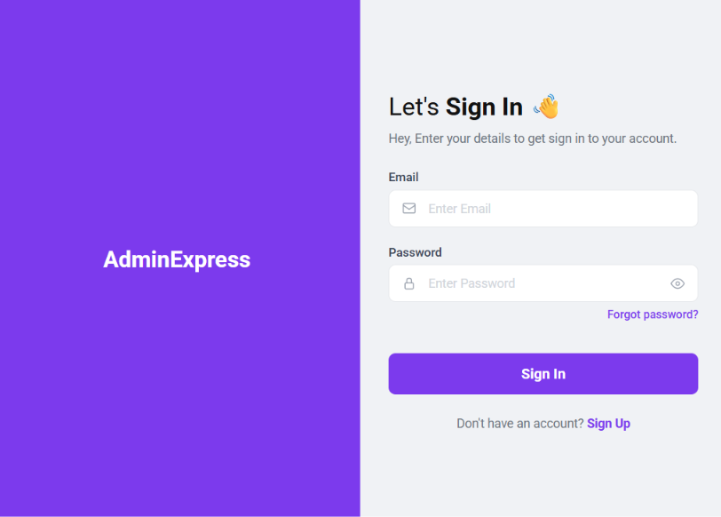
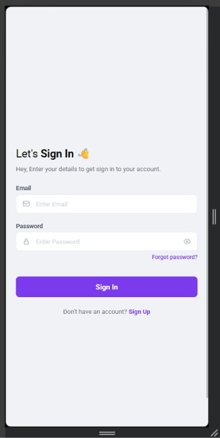

# Login Page con HTML y CSS

Réplica de un diseño de página de login usando **HTML5**, **CSS** y **Media Queries**.  
El diseño es responsive y se adapta a distintos tamaños de pantalla.

---

## Vista en escritorio (> 900px)

Layout de dos columnas con CSS Grid:
- **Panel izquierdo:** fondo morado con el nombre de la app.
- **Panel derecho:** formulario de inicio de sesión.

<!-- imagen escritorio -->


---

## Vista en tableta (641px – 900px)

El panel izquierdo se mantiene pero con texto más pequeño.  
El formulario ocupa el 50% restante de la pantalla.

<!-- imagen tableta -->


---

## Vista en móvil (≤ 640px)

El panel de marca desaparece.  
El formulario ocupa toda la pantalla en una sola columna, centrado vertical y horizontalmente.

<!-- imagen móvil -->


---

## Estructura de archivos

```
AC Armado Login/
├── index.html      → estructura semántica HTML5
├── styles.css      → estilos y media queries
└── screenshots/    → imágenes para este README
```

---

## Tecnologías usadas

- HTML5 (etiquetas semánticas: `main`, `aside`, `section`, `header`, `footer`, `fieldset`)
- CSS Grid para el layout de dos columnas
- Media Queries para el diseño responsive
- Google Fonts – Roboto
